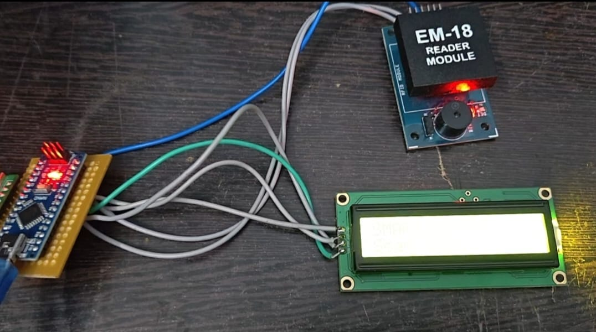

# RFID Smart Attendance System

## Project Overview

The RFID Smart Attendance System is an embedded systems project developed using Arduino Nano, an EM-18 RFID reader module, an LCD display, and RFID cards. The system identifies students using their unique RFID card IDs and displays their attendance status on the LCD.

When a registered student scans their card for the first time, their attendance is marked. If the same student scans the card again, the system displays "Already Present" to prevent duplicate attendance entries. If an unregistered card is scanned, the LCD displays "Not Registered".

##  Objectives

- Identify students using unique RFID card IDs.
- Mark attendance for registered students.
- Prevent duplicate attendance entries.
- Display student names and attendance status on the LCD.
- Identify and reject unregistered RFID cards.
- Understand RFID communication and microcontroller interfacing.

## Components Required

- Arduino Nano
- EM-18 RFID Reader Module
- LCD Display
- RFID Cards 
- Jumper Wires
- USB Cable for programming and power

## Circuit Diagram

The circuit connects the EM-18 RFID reader and LCD display to the Arduino Nano. The Arduino processes the scanned card ID, checks the registered student list, and displays the corresponding message on the LCD.

## Project Demonstration

Watch the demonstration video to see how the RFID Smart Attendance System identifies registered students, marks attendance, prevents duplicate entries, and handles unregistered cards.

[▶️ View Project Demonstration Video](https://drive.google.com/file/d/1mZxaQ7Twpr6SubX0deKlrMR6PnXgWbRp/view?usp=drivesdk)

##  Working Principle

1. The Arduino Nano initializes the RFID reader and LCD display.
2. Each registered RFID card is associated with a unique card ID and student name.
3. When a card is scanned, the EM-18 reader reads its ID and sends the data to the Arduino Nano.
4. The Arduino compares the scanned ID with the registered student records.
5. If the card is registered and the student has not been marked present, attendance is marked and the student's name and attendance status are displayed.
6. If the same card is scanned again, the LCD displays "Already Present".
7. If the scanned card ID is not registered, the LCD displays "Not Registered".

## Attendance Workflow

| Condition | LCD Output | Action |
|---|---|---|
| First scan by NAVEENA | NAVEENA - Attendance: YES | Attendance marked |
| NAVEENA scans again | Already Present | Duplicate entry prevented |
| ARUN scans their card | ARUN - Attendance: YES | ARUN's attendance marked independently |
| PRIYA scans their card | PRIYA - Attendance: YES | PRIYA's attendance marked independently |
| Unknown card scanned | Not Registered | Attendance not marked |

## Key Features

- **RFID-Based Identification:** Identifies students using unique RFID card IDs.
- **Student Name Display:** Displays the registered student's name on the LCD.
- **Duplicate Prevention:** Prevents the same student from being marked present more than once during the current attendance session.
- **Independent Attendance:** Maintains a separate attendance status for each registered student.
- **Unknown Card Detection:** Rejects unregistered cards and displays an appropriate message.
- **Real-Time Feedback:** Displays the result of each card scan on the LCD.

## Software Requirements

- Arduino IDE
- Appropriate LCD library, depending on the LCD interface
- USB driver for the Arduino Nano
- Serial Monitor for debugging

## Setup and Execution

1. Assemble the circuit according to the circuit diagram.
2. Connect the EM-18 RFID reader and LCD display to the Arduino Nano.
3. Open the project program in the Arduino IDE.
4. Select the appropriate Arduino Nano board and COM port.
5. Verify the program and upload it to the Arduino Nano.
6. Register the RFID card IDs and associate each ID with the correct student name in the program.
7. Power on the system and wait for the LCD initialization.
8. Scan a registered RFID card and observe the attendance status.
9. Scan the same card again to verify duplicate prevention.
10. Scan another registered card to verify independent attendance.
11. Scan an unregistered card to verify the "Not Registered" message.

## Applications

- Classroom attendance monitoring
- College laboratory attendance
- Student identification systems
- Training centre attendance
- Small-scale employee attendance prototypes
- RFID-based access and identification systems

## Learning Outcomes

- Arduino Nano programming
- RFID reader interfacing
- Serial communication fundamentals
- LCD interfacing and message display
- Unique ID identification and comparison
- Conditional logic and duplicate-entry prevention
- Hardware-software integration
- Embedded systems debugging

## Future Improvements

- Store attendance records with timestamps.
- Add an SD card or computer-based database for attendance storage.
- Export attendance records to CSV or Excel.
- Integrate Wi-Fi connectivity using ESP32 for online monitoring.
- Develop a web dashboard for attendance reports.
- Add date-wise attendance tracking and reporting.

## Conclusion

The RFID Smart Attendance System demonstrates how RFID technology and embedded systems can automate student identification and attendance marking. By using unique card IDs, individual attendance tracking, duplicate prevention, and unknown-card detection, the project provides a foundation for developing more advanced automated attendance solutions.

## Technologies Used

`Arduino Nano` `EM-18 RFID Reader` `RFID` `LCD Display` `Embedded C/C++` `Arduino IDE` `Serial Communication` `Embedded Systems`
